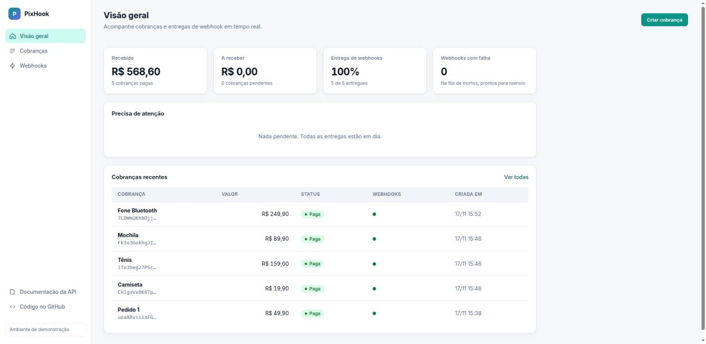
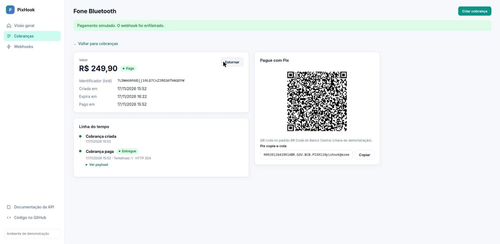

# PixHook

[](https://github.com/jose-dev86/pixhook/actions/workflows/ci.yml)

Simulador de gateway Pix em **Ruby on Rails 8**. Cria cobranças com **idempotência**, entrega **webhooks assinados (HMAC-SHA256)** ao lojista com **retentativas no Sidekiq** e mostra tudo num painel em tempo real com **Hotwire**.

É um projeto de portfólio: os problemas são os mesmos de uma integração de pagamentos real (requisições duplicadas, rede instável, lojista fora do ar, ataques de replay), em escala pequena.

- **Demo:** _link do Render após o deploy_ (plano gratuito: a primeira requisição pode levar ~1 min para acordar o servidor)
- **API (OpenAPI/Swagger):** `/api-docs`

| Visão geral | Detalhe da cobrança |
|---|---|
|  |  |

## Painel

Inspirado em painéis de pagamento como Stripe e Asaas, em pt-BR e com tema claro/escuro automático:

- **Visão geral** com indicadores (recebido, a receber, taxa de entrega de webhooks, falhas) e uma fila "Precisa de atenção" com os webhooks que falharam e o botão de reenviar.
- **Cobranças** com filtro por status, valores alinhados à direita e atualização ao vivo (Turbo Streams).
- **Detalhe da cobrança** com **QR code Pix no padrão BR Code do Banco Central** (EMV com CRC16, legível por apps de banco; a chave é de demonstração), "copia e cola" com botão de copiar (Stimulus) e **linha do tempo das entregas** com tentativas, código HTTP, payload e reenvio.
- **Criar cobrança** pelo próprio painel: o formulário carrega uma chave de idempotência, então um clique duplo não duplica a cobrança.
- **Webhooks**: todas as entregas, com status traduzidos e reenvio manual.

## O que dá para ver aqui

| Problema | Solução no código |
|---|---|
| Cliente reenvia o mesmo POST (timeout, clique duplo) | Header `Idempotency-Key` + índice único `(merchant_id, idempotency_key)` + fingerprint do corpo. Mesma chave e mesmo corpo devolvem a cobrança original (`200`, `Idempotent-Replayed: true`); corpo diferente devolve `409`. Corrida entre requisições simultâneas é resolvida pelo índice (`RecordNotUnique`). [`CreateCharge`](app/services/create_charge.rb) |
| Mudança de status e evento de webhook não podem se perder | **Outbox**: o status e o `WebhookEvent` são gravados na mesma transação, com lock da linha; o job só é enfileirado **depois do commit** (`after_create_commit`). Nenhuma chamada HTTP acontece dentro de transação. [`Charge#transition!`](app/models/charge.rb) |
| Lojista fora do ar ou lento | `WebhookDeliveryJob` com timeouts explícitos (2 s conexão / 5 s leitura), backoff exponencial com jitter, 8 retentativas e **fila de mortos** (`status: dead`) com reenvio manual pela API. O job é **idempotente**: evento já entregue não é reenviado. [job](app/sidekiq/webhook_delivery_job.rb) |
| Garantir ao lojista que o webhook é nosso | Assinatura no formato `t=<timestamp>,v1=<hmac>` (como Stripe), comparação em tempo constante e **janela anti-replay de 5 min**. Há um [receptor de exemplo](app/controllers/demo/webhook_receiver_controller.rb) que valida a assinatura. |
| Cobrança Pix expira | Job agendado para `expires_at`, seguro para rodar mais de uma vez e para a corrida com o pagamento. |
| Abuso da API | `rate_limit` nativo do Rails 8 (60 req/min por API key); API keys guardadas só como **SHA-256**. |
| Integridade no banco, não só no Rails | `CHECK` constraints para valor positivo e status válido, chaves estrangeiras e índices únicos. |
| Observabilidade | Logs JSON com `request_id` (Lograge), healthcheck em `/up`, tentativas e último erro registrados por evento. |

## Arquitetura

```mermaid
sequenceDiagram
    participant L as Lojista
    participant API as Rails API (Puma)
    participant DB as PostgreSQL
    participant Q as Sidekiq (Redis)
    participant W as Endpoint do lojista

    L->>API: POST /api/v1/charges (Idempotency-Key)
    API->>DB: INSERT charge (índice único da chave)
    API-->>L: 201 Created (ou 200 replay / 409 conflito)
    L->>API: POST /charges/:txid/pay
    API->>DB: BEGIN; lock; status=paid; INSERT webhook_event; COMMIT
    API->>Q: enqueue WebhookDeliveryJob (after commit)
    Q->>W: POST assinado (HMAC, timeouts)
    W-->>Q: 2xx → delivered | erro → retry com backoff → dead
    API-->>L: painel atualizado via Turbo Streams
```

## Decisões (ADR curto)

1. **Outbox em vez de enfileirar dentro da transação.** Se o job fosse enfileirado antes do commit, o worker poderia ler um registro que ainda não existe, ou o webhook sairia para uma cobrança cujo commit falhou.
2. **Sidekiq embutido no Puma no deploy gratuito.** O Render grátis não tem worker separado, então `SIDEKIQ_EMBEDDED=true` roda o Sidekiq dentro do processo web (modo embed). Em produção de verdade o worker seria um processo separado; o código não muda.
3. **Fingerprint do corpo na idempotência.** Sem ele, reutilizar a chave com outro valor devolveria silenciosamente a cobrança errada.
4. **Status como string + `CHECK` no banco.** Legível em consultas e logs, e o banco recusa estados inválidos mesmo fora do Rails.

## Rodando localmente

Com Docker:

```bash
docker compose up
# http://localhost:3000 — a API key do lojista demo aparece no log do seed
```

Sem Docker (Ruby 4.0.5, PostgreSQL e Redis locais):

```bash
bin/setup
bin/rails db:seed            # imprime a API key
SIDEKIQ_EMBEDDED=true bin/rails server
```

Testando a API:

```bash
KEY=pk_...   # API key do seed
curl -X POST localhost:3000/api/v1/charges \
  -H "Authorization: Bearer $KEY" -H "Content-Type: application/json" \
  -H "Idempotency-Key: pedido-1" \
  -d '{"charge":{"amount_cents":4990,"description":"Pedido 1"}}'

curl -X POST localhost:3000/api/v1/charges/<txid>/pay -H "Authorization: Bearer $KEY"
curl localhost:3000/api/v1/webhook_events -H "Authorization: Bearer $KEY"
```

## Testes e qualidade

```bash
bundle exec rspec          # 80+ exemplos, cobertura de linha ~98% (SimpleCov, mínimo 90%)
bin/rubocop                # rubocop-rails-omakase
bin/brakeman               # análise estática de segurança
bin/bundler-audit          # gems vulneráveis
RAILS_ENV=test COVERAGE=false bundle exec rake rswag:specs:swaggerize   # regenera o OpenAPI
```

Os request specs são a própria documentação: o `swagger/v1/swagger.yaml` é gerado a partir deles (rswag). Os jobs são testados com WebMock (sucesso, 5xx, timeout, fila de mortos) e a assinatura com casos de corpo adulterado, segredo errado e replay.

O CI (GitHub Actions) roda RSpec com PostgreSQL e Redis, RuboCop, Brakeman, bundler-audit e auditoria do importmap.

## Deploy (custo zero)

- **Web + Sidekiq embutido:** Render free (`render.yaml`, Blueprint).
- **PostgreSQL:** Neon free (`DATABASE_URL`).
- **Redis:** Key Value free do Render (em memória; aceitável para demo).

## Próximos passos

- Proteção contra SSRF no `webhook_url` (bloquear IPs privados e resolver DNS antes de enviar).
- Rotação de `webhook_secret` com dois segredos válidos durante a transição.
- Métricas de entrega (taxa de sucesso, latência) expostas para Prometheus.
- Estornos parciais.

---

Feito por [José Vitor Araujo](https://www.linkedin.com/in/jos%C3%A9-vitor-araujo-b2198639a/) — desenvolvedor Ruby on Rails.
